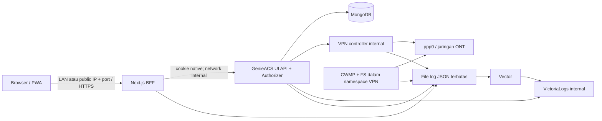

# Spesifikasi dan kontrak implementasi

Status: rancangan lengkap untuk review, 1 November2026. Keputusan pengguna
berada di [decision-register.md](decision-register.md). Paket M01–M09
mengimplementasikan kontrak ini secara bertahap; sesi ini hanya menulis dokumen.
Nama path/signature di sini adalah target yang akan dibuat, bukan klaim kode
sudah tersedia.

## Batas sistem dan topologi

Satu ISP per instalasi; satu pelanggan≈satu ONT utama; 10.000 ONT/20 operator.
Engine tetap GenieACS v1.2.16 dengan upgrade dependency keamanan terpisah.
Next.js tidak menulis collection operasional GenieACS langsung.



Service Compose: `web`, `acs-ui`, `acs-nbi`, `cwmp`, `fs`, `vpn`, `mongo`,
`vector`, `victorialogs`. NBI internal untuk integrasi terpisah, tidak menjadi
transport aksi browser. cwmp/fs menggunakan `network_mode: service:vpn`;
acs-ui/web/mongo/log tetap pada bridge internal. Port host: web3000/tcp (dapat
diganti), cwmp7547/tcp dan fs7567/tcp dipublikasi oleh service vpn. Tidak
memublikasikan Mongo27017, NBI7557, UI3000 internal, agent9071 atau
VictoriaLogs9428.

Jaringan `app` untuk web↔acs-ui dan layanan backend; `vpn-control` internal
untuk acs-ui↔vpn; akses tunnel keluar tetap melalui jaringan egress vpn. web
tidak bergabung ke vpn-control. Port tidak otomatis membuka firewall
host/provider. UI menampilkan alamat dashboard, URL ACS advertised dan URL file
sebagai konfigurasi terpisah. Berkas firmware harus reachable dari ONT lewat
FS_URL_PREFIX yang dikonfigurasi; jangan menurunkannya dari URL browser.

`compose.yaml` untuk aplikasi, `compose.test.yaml` untuk simulator dan fixture,
`compose.https.yaml` opsional reverse proxy TLS terpercaya. Image dibangun dari
fork, bukan patch bundle runtime image pihak ketiga. Node target24.22.2/
Mongo8.0.34; digest diselesaikan dan dicatat M01-A sesuai riset keamanan.
Caddy2.11.7 menjadi reverse proxy TLS overlay; cert/key trusted dimount
read-only, timeout upstream task≥310detik dan upload stream100MiB. Tag Caddy
diverifikasi melalui
[release resmi](https://github.com/caddyserver/caddy/releases/tag/v2.11.7)
3Oktober2026; digest dan scan image tetap gate M01-D. amd64 Linux/WSL2 adalah
target pembuktian awal. Platform tambahan perlu CI image dan uji PPP tersendiri.

## Peta source dan tanggung jawab

| Path target                    | Tanggung jawab                                                                          |
| ------------------------------ | --------------------------------------------------------------------------------------- |
| `apps/web`                     | Next App Router, React, CSS Modules, BFF same-origin                                    |
| `packages/app-contracts/src`   | DTO/result/error/log/schema validator pure TS; tidak mengimpor Node di browser          |
| `packages/device-profiles/src` | resolver vendor/model/firmware, aturan WAN dan task builder pure TS                     |
| `lib/ui/app-api.ts`            | endpoint tambahan yang memakai Authorizer native                                        |
| `lib/ui/device-commands.ts`    | eksekusi task berizin, guard dan normalisasi hasil; dipakai route lama dan baru         |
| `lib/ui/app-settings.ts`       | konfigurasi instalasi persisten, CAS revision, enkripsi secret                          |
| `lib/app-logger.ts`            | redaksi/envelope JSON; adaptor logger engine tetap menjaga keluaran CLI lama bila perlu |
| `services/vpn-controller/src`  | satu state machine L2TP, control API terbatas, render konfigurasi                       |
| `docker`                       | build/deploy/health/preflight tanpa data operasional                                    |
| `test/fixtures`                | konfigurasi/perangkat sintetis tanpa secret nyata                                       |
| `test/integration`             | simulator backend/PPP/log/DB; semua mutasi pada project uji                             |
| `scripts`                      | pemeriksaan dependency, fixture kapasitas, parity dan release                           |

Root npm-shrinkwrap dan apps/web package-lock terpisah. Contracts/profiles
diimpor sebagai source TS melalui alias tsconfig; tidak menambah framework ke
package backend. Test root tetap node:test; frontend Vitest/TestingLibrary dan
Playwright. React state/fetch/AbortController dipakai tanpa query/form library
tambahan; operasi tulis tidak mempunyai automatic retry.

## Identitas dan otorisasi

1. Browser mengakses `POST /api/app/login` dengan JSON username/password. BFF
   melakukan satu POST `/login` internal, mengambil JWT native dan menyimpannya
   sebagai cookie `genieacs-ui-jwt` HttpOnly, SameSite=Lax, Path=/,
   Max-Age=28800, Secure hanya pada mode HTTPS terpercaya. Token/body native
   tidak dikirim ke JavaScript/browser response.
2. Native login menandatangani JWT dengan `expiresIn:"8h"`. Native middleware
   menolak token tanpa exp/iat atau masa >8h setelah migrasi; pengguna lama
   login ulang. BFF juga membatasi cookie8h, tidak memperpanjang otomatis.
3. Backend tetap mengambil user/role/permission dari snapshot native pada setiap
   request (refresh5detik). Target uji perubahan izin berlaku≤10detik, tanpa
   menunggu8jam. User dihapus tidak dapat memakai token lama.
4. `GET /api/session` native mengembalikan SessionDTO terpilih; jangan serialize
   getUsers()/snapshot. Konfigurasi UI hanya subtrees yang diekspor oleh
   local-cache, ditambah setting tampilan fontSize yang diseleksi eksplisit.
   Tidak pernah mengekspor cwmp.auth/password/salt.
5. BFF meneruskan cookie native hanya ke origin internal tetap. Seluruh resource
   tetap diperiksa Authorizer server; menu UI hanya petunjuk akses.
6. Semua mutation BFF wajib Origin sama dengan `PUBLIC_ORIGIN` tervalidasi dan
   header `X-App-Request: 1`; tolak missing/berbeda. File upload memakai header
   yang sama. GET tidak mengubah data. Proxy menghapus user-supplied forwarded
   headers dan menetapkan sendiri bila diperlukan.
7. Logout native + hapus cookie BFF, hapus state/fetch aktif, staging/task,
   clear Query/form/password dari memory. Tidak mengklaim revokasi token curian
   seketika dengan logout saja; maksimum masa token tetap8jam.
8. Login rate limit 10 kegagalan/15menit per IP+username, respon429 Retry-After,
   tanpa log password. Implementasi satu replica awal; multi-replica limiter
   memerlukan store bersama sebelum scale web horizontal.
9. Penggantian password sendiri lewat endpoint khusus menggunakan authLocal
   untuk password lama dan native hash/salt, bukan hak users:write implisit.
   Admin reset tetap jalur native users/password dengan permission/validator.

```ts
type Expression = null | boolean | number | string | Expression[];
interface SessionDTO {
  username: string;
  roles: string[];
  permissionSets: Record<
    string,
    {
      access: number;
      filter?: Expression;
      validate?: Expression;
    }
  >[];
  expiresAt: string; // ISO UTC
  configRevision: string;
  uiConfig: Record<string, unknown>;
  appVersion: string;
  upstreamVersion: string;
}
```

Permission tambahan: `vpn` access1=status/diagnosis, access3=write/reconnect/
reset-bootstrap; `logs` access2=global search, access3=export. Seed admin
mendapat vpn3/logs3; operator/teknisi vpn1 dan tidak mendapat logs. Seed admin
memakai filter=true/validate=true secara eksplisit; operator status memakai
filter=true tanpa validator mutation. Role existing tidak otomatis ditingkatkan;
admin memeriksa migrasi permission. Gunakan getFilter/getValidator untuk
resource tambahan juga, bukan hasAccess saja. Device-diagnostic ringkas memakai
devices access2+filter objek dan query internal fixed field; tidak membolehkan
query log arbitrer.

## Transport dan error

Public prefix `/api/app`. Route handlers BFF adalah allowlist, bukan catch-all
proxy URL bebas. `createApiClient(fetch)` menghasilkan
`apiRequest<T>(path, init):Promise<ApiResult<T>>` dan tidak melempar untuk error
HTTP yang dikenal. Semua respon app memakai bentuk berikut, kecuali
CSV/file/export streaming yang mempunyai Content-Type dan status normal.

```ts
type ErrorCode =
  | "UNAUTHENTICATED"
  | "FORBIDDEN"
  | "NOT_FOUND"
  | "VALIDATION"
  | "CONFLICT"
  | "RATE_LIMITED"
  | "BACKEND_UNAVAILABLE"
  | "TIMEOUT"
  | "VPN_UNAVAILABLE"
  | "DEVICE_UNREACHABLE"
  | "DEVICE_FAULT"
  | "PARTIAL_RESULT"
  | "RESULT_UNKNOWN"
  | "LOGGING_DEGRADED"
  | "UNSUPPORTED_PROFILE"
  | "STORAGE_ERROR"
  | "INTERNAL";
type ApiResult<T> =
  | { ok: true; data: T; requestId: string }
  | {
      ok: false;
      error: {
        code: ErrorCode;
        message: string;
        fieldErrors?: Record<string, string>;
        retryable: boolean;
      };
      requestId: string;
    };
type ResourceName =
  | "devices"
  | "presets"
  | "provisions"
  | "virtualParameters"
  | "files"
  | "config"
  | "users"
  | "permissions"
  | "faults"
  | "tasks";
interface ListQuery {
  filter: string;
  page: number;
  pageSize: 25 | 50 | 100;
  sort: Record<string, 1 | -1>;
  projection: string[];
}
interface Page<T> {
  items: T[];
  total: number | null;
  page: number;
  pageSize: 25 | 50 | 100;
  hasNext: boolean;
  observedAt: string;
  source: "live";
}
```

HTTP mapping:400 VALIDATION,401 login,403 permission,404 missing/filtered, 409
conflict,429 rate limit,502 upstream error,503 unavailable,504 timeout. Task
selesai tetapi fault/partial adalah response hasil operasi yang menyatakan
statusnya secara eksplisit; tidak disimpulkan dari HTTP200. Pesan publik tanpa
stack/raw upstream body. ID UUID request server-generated; valid inbound UUID
dapat menjadi parentRequestId, bukan identitas audit.

Header setiap private response: `Cache-Control: private, no-store`. Body
maksimum mutation1MiB; upload file batas100MiB, streaming dan abort; tidak
buffer file dalam RAM. Read timeout10detik; health2detik; task BFF310detik
(native socket300, await session120), progress UI tetap aktif. Browser fetch
task tidak auto retry; lost connection memberi RESULT_UNKNOWN dan menampilkan
tombol refresh hasil, bukan tombol ulang otomatis.

## Daftar API dan adapter

| BFF route                                                             | Native/action                                                                                                 |
| --------------------------------------------------------------------- | ------------------------------------------------------------------------------------------------------------- |
| POST login/logout, GET session                                        | native /login, /logout, /api/session                                                                          |
| GET health                                                            | no-store; web alive, backendReachable, logging state, observedAt; tanpa detail/secret internal bagi anonymous |
| GET resources/:resource                                               | GET + HEAD native /api/:resource; limit/skip/sort/filter/projection                                           |
| GET/PUT/DELETE resources/:resource/:id                                | allowlist verb native dan permission; encoded ID satu kali                                                    |
| GET resources/:resource/csv                                           | native CSV + columns; batasi query/row, stream                                                                |
| GET devices/:id                                                       | native devices detail                                                                                         |
| POST devices/:id/commands                                             | native app endpoint executeAuthorizedTasks                                                                    |
| GET operations/:operationId                                           | owner atau admin berizin device; tanpa payload secret                                                         |
| POST devices/:id/wan                                                  | orchestrator full WAN/guard; bukan query URL bebas                                                            |
| GET devices/:id/profile                                               | resolver profil + capabilities, tanpa password                                                                |
| POST devices/:id/tags                                                 | native tag route sesuai verb, jangan pakai generic PUT devices                                                |
| POST devices/:id/diagnostics                                          | ping target dari device berizin, fixed checks                                                                 |
| GET/POST files/:id/content                                            | native file GET/PUT octet-stream sesuai route; stream + size/checksum                                         |
| GET/PUT settings                                                      | native app-settings, vpn access3                                                                              |
| GET vpn/status; POST vpn/reconnect, vpn/diagnose, vpn/reset-bootstrap | native app-api memeriksa izin lalu controller internal                                                        |
| GET logs; GET logs/export                                             | native app-api membangun LogsQL aman, logs2/logs3                                                             |
| POST client-errors                                                    | logged-in, whitelist event, rate10/menit/user, body≤16KiB                                                     |
| POST password                                                         | native self-password baru; admin reset tetap resource users/password                                          |
| GET/POST setup                                                        | native /init status dan init action, hanya installer pertama atau authorized native admin                     |

Generic resource adapter mempunyai explicit map verb/path per resource dari
`lib/ui/api.ts`; tidak menyediakan PUT files/devices/tasks yang tidak didukung.
Bulk tags/delete/commands memanggil operasi satu target dengan hasil per target,
max100 target, concurrency4, cancel hanya mencegah target yang belum dikirim.
CSV daftar maksimal10.000 baris per export, columns allowlist/config, filter
tetap native. Escape formula pada nilai awal =,+,-,@ untuk spreadsheet; operator
mendapat pemberitahuan transformasi. Parameter password disamarkan sebelum CSV.
Export admin raw config/script dapat mengandung secret yang sengaja disimpan
admin: perlu izin resource/konfirmasi, private/no-store, tanpa log isi.

Pagination server offset: page≥1, pageSize25 default; stable sort menambahkan
DeviceID.ID untuk devices atau \_id resource lain sebagai tie-breaker. HEAD
count memakai izin access1; bila list diizinkan tetapi count tidak, total=null
dan UI memakai navigasi Next/Previous dengan overfetch1 di server. Adapter
meminta paling banyak pageSize+1, mengembalikan items≤pageSize dan hasNext dari
count atau baris tambahan. Jangan menampilkan total=0 saat count ditolak. Daftar
tidak mengambil semua device lalu memotong di browser. Filter expression parser
GenieACS dipakai tanpa eval. Search string di-escape melalui AST/stringify,
bukan interpolasi bebas. Filter tersimpan di URL, debounce300ms, batalkan
request lama dan abaikan respon yang terlambat.

Index awal engine: serialnumber, manufacturer/productclass, lastInform, tags dan
management IP hanya berdasarkan hasil explain fixture10k. Skrip M04 menghasilkan
index manifest dari path Mongo actual (bukan nama DTO flatten). Indeks compound
memuat field sort/filter yang terbukti; jangan indeks seluruh parameter dinamis.
Fitur filter arbitrer tetap ada, query mahal dibatasi waktu/ ditampilkan sebagai
lambat; target2detik berlaku skenario benchmark terdaftar.

## Task, profil perangkat, WAN dan WiFi

```ts
type OperationState =
  | "in_progress"
  | "succeeded"
  | "failed"
  | "partial"
  | "unknown";
interface TaskInput {
  name:
    | "getParameterValues"
    | "setParameterValues"
    | "refreshObject"
    | "addObject"
    | "deleteObject"
    | "download"
    | "provisions"
    | "reboot"
    | "factoryReset";
  parameterNames?: string[];
  parameterValues?: [string, string | number | boolean, string?][];
  objectName?: string;
  fileType?: string;
  fileName?: string;
  file?: string;
  targetFileName?: string;
  expiry?: number;
  provisions?: [string, ...Expression[]][];
}
interface DeviceCommandRequest {
  operationId: string;
  deviceId: string;
  tasks: TaskInput[]; // shape per name divalidasi native, max100
}
interface CommandOutcome {
  operationId: string;
  deviceId: string;
  state: OperationState;
  phases: {
    name: string;
    state: OperationState;
    taskIds: string[];
    faultCode?: string;
    errorCode?: ErrorCode;
  }[];
  refreshedAt?: string;
}
interface DeviceProfile {
  id: string;
  vendor: string;
  model: string;
  firmware: string;
  verified: boolean;
  root: "InternetGatewayDevice" | "Device";
  wan: boolean;
  wifi: boolean;
}
```

Task payload memakai type native `Task`, bukan payload perangkat baru.
packages/app-contracts memvalidasi whitelist task names dan fieldnya, typed SPV
tuple `[parameter,value,xsdType]`. Refresh/reboot/factoryReset/download/
addObject/deleteObject/setParameterValues mengikuti native schema. Engine
mengisi device, menghapus client \_id, menegakkan max100 server-side.

Mongo `app_operations` menyimpan operationId unik, user, device, kind, HMAC
fingerprint request, phase/result timestamps dan expiresAt24jam. Tidak ada
payload password atau worker queue. Claim atomik mencegah double submit: ID
sama+fingerprint sama mengembalikan status tersimpan; beda mendapat409. Result
dibaca owner dengan devices:2/filter target; admin lain memerlukan logs:2 serta
devices:2/filter target. Tidak memakai nama role hardcode. Proses yang crash
saat in_progress menjadi unknown pada startup, bukan diputar ulang. TTL hanya
untuk diagnosis/idempotensi24jam. Semua mutation perangkat menggunakan ID baru
dari crypto.randomUUID untuk tindakan baru.

Guard WAN manajemen diperiksa backend sebelum **semua** task relevan, termasuk
raw SPV/deleteObject route lama. Ambil device fresh berizin, tentukan management
WAN dari CRURL host/IP WAN; jika ambigu, tolak destructive WAN edit dengan
VALIDATION dan instruksi diagnosis. Jangan memblok reboot/factoryReset native
secara keliru; tindakan itu memakai konfirmasi eksplisit target.

Profil awal persis F670 V6.0.10P3N19, F670 V6.0.10P3N3, F609 V5.2.10P5T13.
Aturan enum/service dan regresi **otoritatif** di
[feature-parity.md](feature-parity.md). Firmware lain memakai generic parameter
read; WAN write khusus dinonaktifkan UNSUPPORTED_PROFILE. Huawei/FiberHome
tercakup model extensible/vendor UI, belum berlabel verified. Tidak mengklaim
semua firmware didukung dengan regex vendor.

WAN orchestrator: validate/authorize/guard → complete typed write/AddObject
initial values → inspect native task outcome → refresh → bila bridge mode
berubah dan refresh berhasil, reapply binding → refresh hasil. Setiap phase
dicatat. Phase gagal menghentikan phase berikut. AddObject dapat meninggalkan
instance kosong: tampilkan partial, refresh dan ID instance; tanpa recreate
otomatis. Follow-up binding adalah bagian satu operasi, bukan retry task gagal.

WiFi manager memisahkan SSID/Enable/key dari WAN binding. Mapping diambil dari
parameter writable yang ada pada fixture, bukan hardcode SSID1=2.4GHz. Password
existing kosong=keep, new PPP wajib isi; explicit boolean/value types; secret
hanya berada di memory form sampai submit kemudian dihapus. Device
detail/CSV/log/staging tidak mengungkap nilai secret.

## Konfigurasi dan kontrol VPN

```ts
interface AcsAddress {
  mode: "manual" | "auto-ppp";
  scheme: "http" | "https";
  host: string | null;
  port: number;
  path: string;
}
interface VpnProfileInput {
  revision: number;
  server: string;
  username: string;
  passwordAction: "keep" | "replace";
  password?: string;
  routes: string[];
  mtu: number;
  acs: AcsAddress;
}
interface VpnProfileView {
  revision: number;
  server: string;
  username: string;
  passwordConfigured: boolean;
  routes: string[];
  mtu: number;
  acs: AcsAddress;
  updatedAt: string;
}
type VpnState =
  | "unconfigured"
  | "connecting"
  | "connected"
  | "retry_wait"
  | "auth_failed"
  | "route_error"
  | "host_unsupported"
  | "stopped";
interface VpnStatus {
  state: VpnState;
  desiredRevision: number;
  appliedRevision: number | null;
  interfaceName: string | null;
  localIp: string | null;
  peerIp: string | null;
  attempt: number;
  nextAttemptAt: string | null;
  lastErrorCode: string | null;
  observedAt: string;
  routes: { cidr: string; installed: boolean }[];
}
```

Mongo `app_settings` singleton \_id=installation, schemaVersion1, revisionCAS,
saved VPN/ACS settings, installationId(UUID), encrypted password blob AES256GCM.
Secret key32bytes disediakan file Docker secret lokal (bukan Git); key hilang/
decrypt gagal → STORAGE_ERROR, jangan overwrite profil atau fallback .env.
Password API read hanya passwordConfigured. Empty replacement ditolak; keep
tanpa existing secret ditolak pada bootstrap.

Bootstrap hanya jika singleton belum ada. Nilai `VPN_SERVER`, `VPN_USERNAME`,
`VPN_PASSWORD_FILE`, `VPN_ROUTES`, `VPN_MTU`, `ACS_HOST`/port/scheme/path
ditransformasi ke DTO. UI save menang atas perubahan env berikutnya.
Reset-bootstrap membutuhkan vpn3+validator, revision, konfirmasi literal
`RESET`; log revision sebelum/sesudah tanpa secret. Reset gagal tidak menghapus
profil valid yang tersimpan. Update settings tidak diam-diam menulis URL ke
semua ONT; perubahan ACS mempunyai dialog dampak/reprovision terpisah.

Controller API internal dengan shared bearer token file: `GET /health`,
`GET /status`, `PUT /profile`, `POST /reconnect`, `POST /diagnose`. Schema
strict, requestIdUUID, revision; tanpa shell string/ command bebas. Node spawn
argv fixed untuk xl2tpd/pppd/ip. Credentials ditulis file0600 pada volume
vpn-private; config ter-escape ketat, tolak newline/NUL.

Controller startup meminta desired profile melalui acs-ui internal authenticated
endpoint; token service itu tidak dapat dipakai sebagai user/browser session.
Retry bootstrap acs-ui unavailable10detik, dashboard tetap hidup. Settings save
persist lebih dahulu lalu apply; save berhasil tetapi apply gagal menampilkan
desiredRevision≠appliedRevision dan error, bukan profil lama aktif kembali.

Retry transient10,20,40,60detik lalu60detik, jitter0–20%; satu percobaan/
timeout60detik, reset attempt setelah connected60detik. PPP auth rejection
(exit19 atau event PAP/CHAP authentication failed) → auth_failed tanpa timer.
Manual reconnect atau profil revised membersihkan pause. User-request stop tidak
auto-retry sampai reconnect. Tidak ada rollback profil otomatis.

Routes IPv4 CIDR max32, validate ipaddr.js. Tolak default route0/0, overlap
subnet bridge Docker, route host/dashboard ingress dan CIDR duplikat.
MTU576–1500 default1400. L2TP server IPv4 atau DNS hostname; DNS diresolve
sebelum route, endpoint route lewat egress host tetap. Agent hanya memasang/
menghapus route miliknya; jangan flush route table.

ACS manual: host IPv4/IPv6/DNS tervalidasi tanpa userinfo/query/fragment,
port1–65535, path absolut default /. IPv6 URL bracketed oleh URL API. auto-ppp
tanpa IPv4 → VPN_UNAVAILABLE. DNS tidak otomatis diupdate provider, cert HTTPS
ACS diprovisikan terpisah dan harus trusted ONT. UI memperlihatkan perubahan
URL, resolved IP, PPP IP, dan waktu pemeriksaan.

Preflight mengecek Docker Linux/rootful, kernel/PPP major108, modprobe
ppp_generic/pppol2tp/l2tp_ppp bila disediakan host, device/caps dan subnet
overlap. SYS_MODULE hanya overlay WSL preflight bila benar-benar diperlukan;
Linux host memuat module di luar container kemudian NET_ADMIN + /dev/ppp. WSL
gagal PPP → host_unsupported dengan langkah perbaikan; Docker bukan jaminan
semua kernel mendukung L2TP.

Diagnosis read-only: DNS endpoint, PPP local/peer, daftar route terpasang, TCP
CWMP bind, probe ke target ONT **berizin** melalui controller, serta ACS URL
resolve. ICMP gagal tidak otomatis ONT down; tampilkan source, target, durasi,
observedAt dan batas bukti. Tidak menerima arbitrary host/port scanning.

## Logging terstruktur dan pencarian

```ts
interface LogEvent {
  schemaVersion: 1;
  timestamp: string;
  level: "debug" | "info" | "warn" | "error";
  service: string;
  appVersion: string;
  installationId: string;
  environment: "test" | "production";
  event: string;
  message: string;
  requestId?: string;
  operationId?: string;
  actorId?: string;
  deviceId?: string;
  taskId?: string;
  durationMs?: number;
  outcome?: "success" | "failure" | "partial" | "unknown";
  error?: { code: string; name: string; stack?: string };
  details?: Record<string, unknown>;
}
type LoggingState = "healthy" | "buffering" | "degraded";
interface LogQuery {
  start?: string;
  end?: string;
  service?: string;
  level?: "debug" | "info" | "warn" | "error";
  requestId?: string;
  operationId?: string;
  deviceId?: string;
  limit?: number;
  offset?: number;
}
```

Module tunggal `redact(value):unknown` dan `emitLog(event):void`. Emit tidak
melempar/menggantung request; queue memory max1000event/2MiB, drop debug/info
dahulu saat penuh, counter droppedEvents dan peringatan logging degraded. File
per service NDJSON max20MiB×5 (100MiB), chmod0640, stream async. Disk
penuh/EACCES menandai degraded dan membuang event yang tak dapat disimpan;
fallback stderr hanya envelope aman dengan rate1/menit. stdout Docker logs
dibatasi max-size10m/max-file3 per service.

Redaksi sebelum stdout/file: password/passphrase/secret/token/cookie/
authorization/PPPoE/WPA key, path parameter berakhiran Password/KeyPassphrase/
PreSharedKey, URL userinfo/query token, nested arrays/error cause. Device ID/
actor tersedia untuk audit; log tidak memuat seluruh body/request/headers, raw
CWMP/XML, atau password meski nama field acak. Whitelist details per event;
nilai SPV hanya parameter names dan counts. Stack server max8KiB tanpa
body/headers; browser stack max4KiB/URL tanpa query.

Event minimum: request.completed, request.failed, auth.login_failed,
auth.login_succeeded, permission.denied, device.command.started/completed,
device.wan.phase, settings.updated, vpn.state_changed, vpn.profile_applied,
logs.query, logs.export, logging.state_changed, app.unhandled_error. Browser
error boundary/window.onerror/unhandledrejection melapor tersanitasi; error
proses yang fatal flush≤2detik lalu exit nonzero agar Docker restart. Tidak
mencoba melanjutkan proses Node yang state-nya tak aman.

Vector membaca shared log volume read-only (tanpa Docker socket). Vector state
disk buffer1GiB, when_full block; collector boleh berhenti membaca saat penuh,
aplikasi tetap rotasi file terbatas. VRL redaction kedua drop_on_error:true.
Sink HTTP gzip NDJSON ke:
`/insert/jsonline?_stream_fields=installationId,environment,service&_time_field=timestamp&_msg_field=message`.
Event tinggi kardinalitas (request/device/user/task) tetap JSONfield.

VictoriaLogs retention14d, maxDiskSpaceUsageBytes=10000000000 (10GB desimal,
soft pruning, bukan hard quota), minFreeDiskSpaceBytes=2147483648. Retensi
sesungguhnya dapat lebih pendek; engine dapat menyimpan minimal beberapa
partition sehingga melebihi budget. UI memberi storage warning80%/ 90% budget
dan free disk<2GiB. Data/config+buffer mempunyai volume terpisah. Probe external
Node `GET /health`, bukan CLI healthcheck yang belum tersedia pada1.53.0 atau
curl di image tanpa curl.

Log search default15menit, max24jam/request (14hari via pemilihan window),
limit100/default max500, offset≤5000, query timeout5detik; export≤10.000row/
50MiB dan durasi30detik. Input hanya filter service/level/requestId/
operationId/deviceId/time yang divalidasi; backend membuat LogsQL escaped, tanpa
user-supplied rawquery. Query internal form-urlencoded POST
`/select/logsql/query`; parse NDJSON per baris. VMUI/9428 tidak diakses browser.
Audit pencarian mencatat filter field names, jumlah hasil dan durasi, bukan isi
hasil.

Status logging diperoleh counters local file+Vector+sink, bukan sekadar HTTP200
ingest. Buffering menunjukkan sink down tetapi file/buffer masih tersedia;
degraded bila event hilang/storage gagal/drop. Peringatan admin memuat sejak
kapan/last success/dropped counter; status ringkas operator tanpa akses log
global.

## UX mobile first dan kompatibilitas config

Route UI: /login, /setup, /overview, /devices, /devices/[id], /tasks, /faults,
/admin/presets, /admin/provisions, /admin/virtual-parameters, /admin/files,
/admin/config, /admin/users, /admin/permissions, /settings/vpn,
/diagnostics/logs, /account/password. Detail tabs: Ringkasan, WAN, WiFi,
Parameter, Task/Fault, Diagnosis.

Token CSS: background#F5F9FF, surface#FFFFFF, primary#1D4ED8,
primaryHover#1E40AF, text#0F172A, muted#475569, border#CBD5E1, success#166534,
warning#92400E, danger#B91C1C. Font system-ui lokal, spacing4/8/12/16/24/32px,
radius12px, target sentuh≥44px. Viewport acceptance360×800,768×1024,1440×900;
tanpa overflow halaman. Table boleh scroll di kontainer berlabel; mobile daftar
device menjadi card dengan identitas/status/aksi utama, detail melalui
drawer/fullscreen sheet.

Desktop sidebar tetap; mobile topbar+bottomnav Ringkasan/Perangkat/Diagnosis/
Lainnya. Admin submenu pada Lainnya sesuai permission. Header memisahkan:
Koneksi aplikasi (reachable/unreachable/checking), VPN (state machine),
Perangkat (last Inform/reachability evidence), logging state. Status memakai
ikon+teks, tidak hanya warna. App probe15detik saat visible, timeout2detik; 3
kegagalan→unreachable, pertama gagal→checking, satu sukses→reachable.
navigator.onLine hanya sinyal awal. VPN down tidak memberi label Offline PWA.

Setiap komponen mempunyai loading/empty/error/permission-denied state, retry
baca eksplisit, pesan error+requestId, keyboard/focus restore,
aria-label/aria-live, dialog trapFocus/Escape. Konfirmasi destructive memuat
deviceId/aksi/risiko; tidak menaruh istilah internal framework di flow pengguna.

Config UI native tetap round-trip. Renderer modern memetakan tipe referensi:
parameter-list, parameter-table, container, summon-button, parameter, tags,
overview-dot, ping, device-link, a, device-faults, device-actions,
all-parameters, long-text, loading. Anchor hanya http/https/relative
allowlisted; tidak raw HTML/script/event attributes. Expression memakai
parser/evaluator native pure TS, tanpa eval/new Function. Tipe tak dikenal
tampil placeholder diagnostik dengan config path dan event, data config asli
dipertahankan. Release memerlukan seluruh tipe snapshot referensi mendapat
renderer dan tes; tidak cukup hanya mempertahankan JSON.

## PWA, cache dan update

Manifest standalone, theme_color#1D4ED8/background#F5F9FF, ikon192/512 dan
maskable, start_url=/overview. Aset dibuat lokal, tanpa remote font/CDN. Service
worker plain JS terkontrol, tanpa plugin cache otomatis. Build menghasilkan
allowlist asset hash dari .next/static dan /offline.html + ikon/CSS generik.
Cache `genieacs-shell-<appVersion>-<commit>`.

Fetch handler hanya GET same-origin asset allowlist tanpa query private. Tidak
mengintersep /api, authenticated HTML, RSC request/\_rsc, ServerActions,
file/CSV, login/session/log payload. Navigasi network-only, network gagal →
offline.html generik dengan ikon Offline dan teks "Tampilan tersimpan. Data
perangkat memerlukan koneksi." Tidak menampilkan data ONT lama dari memory
setelah cold start offline. Saat sesi masih terbuka dan koneksi putus, nilai
memory berlabel "Data terakhir, belum diperbarui", semua mutation disabled;
halaman reload offline menjadi shell generik.

Registrasi hanya secureContext + supportedSW; HTTP IP LAN menampilkan mode web
dan petunjuk HTTPS tanpa error console. Worker script no-store, scope/,
updateViaCache:none. Versi baru waiting memberi banner "Pembaruan tersedia".
Pengguna memilih muat ulang setelah form/task aman; tidak skipWaiting otomatis
saat command in-flight. Aktivasi baru menghapus cache versi lama; logout
membersihkan cache prefix dan memory, tidak menghapus cache situs lain.

## Kapasitas, migrasi dan penerimaan

Benchmark fixture sintetis10.000 ONT, parameter representatif1000/device,
staging≤100,20user bersamaan. Hardware4vCPU/8GiB/SSD; simpan profil CPU/RAM/
disk, query matrix, warmup2menit+ukur10menit, p50/p95/p99/errorrate. Target
p95≤2detik: list default/serial/vendor/status/tag/IP, page1/100, sort
serial/lastInform, count berizin. p95 dihitung read API termasukcount, bukan
taskCWMP, download atau fullrawparam. Error<1%, tidak ada taskwrite dalam
benchmark otomatis. Evaluasi burst Inform tersendiri: interval
referensi200detik≈50Inform/detik rata-rata, bukan jaminan kapasitas.

Migrasi memakai backup terenkripsi dan fixture sanitasi. Jangan meng-copy
kredensial literal/provision aktif dari referensi ke seed publik. Seed
idempotent/non-destructive; useradmin tetap nonaktif. Rollout parallel
installation dengan project/port/volume unik, user acceptance, backup/restore
rehearsal, lalu cutover eksplisit; tidak mengganti deployment referensi selama
development. DNS/IP ONT/ACS change memerlukan maintenance dan bukti
reachability, bukan otomatis saat save UI.

Gate release: semua baris feature-parity mempunyai test ID+hasil, seluruh patch
firmware regresi, mobile E2E/console bersih, security graph/image terverifikasi,
failure tests (VPN/DB/log/cache/session) dan backup restore lulus, perangkat uji
nyata yang diklaim verified lulus CWMP+trafik relevan. Ketika lab belum
tersedia, tiket verifikasi tetap blocked/backlog; jangan mengubah klaim verified
atau menandai milestone release selesai.

## Gate temuan keamanan GitHub

[Rencana M01-S1–S9](../superpowers/plans/2026-11-01-genieacs-pwa/m01-security-alerts.md)
dan [register 17 alert](github-security-alerts.md) memperluas fondasi M01
sebelum frontend. Backend diperbaiki secara terbatas pada boundary validasi
script AST, query NBI, escaping error/CSV, parser LIKE/cookie dan kriptografi
per protokol. Job scanner sukses tidak menggantikan pemeriksaan alert
terbuka/scan SHA/ref. Residual protokol legacy harus direview manusia dan diuji
interoperabilitas CPE.
